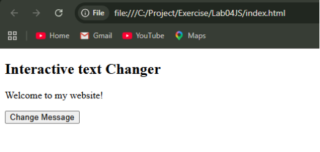
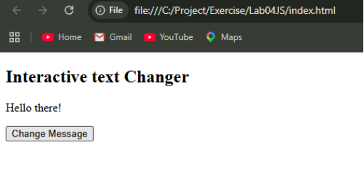
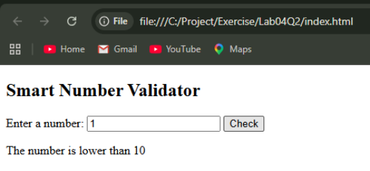
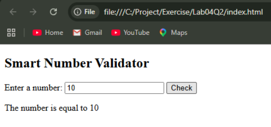
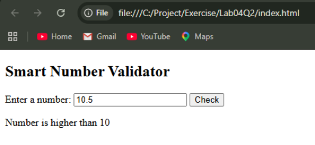
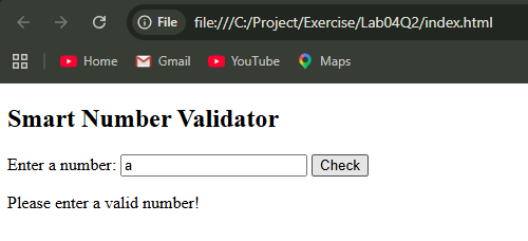
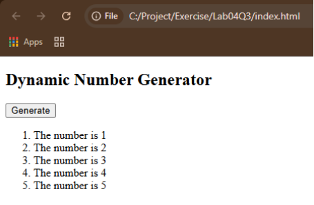

BIC21203 - Web Development
Lab 4a: Client-Side Scripting (JavaScript)

NAME: NUR ZAFIRAH BINTI RIFAI
MATRIC NO.: AI240054
SECTION: 4

In this lab practice, it focuses on client-side JavaScript programming. It demonstrates the use of functions, events, conditions, loops and DOM manipulation.

# Question 1 - Interactive Text Changer
This program changes the paragraph message from "Welcome to my website!" to "Hello there!" when the user clicks the Change Message button.

How to Run the Program:
1. Open the bic21203-lab04-js folder using Visual Studio Code.
2. Open the Lab04Q1 file.
3. Open index.html file using web browser.
4. Click the "Change Message" button.
5. The message "Welcome to my website!" will change to "Hello there!".

Output Screenshots:

# Question 2 - Smart Number Validator
This program checks whether an entered number is lower than, higher than or equal to 10. It also validates invalid inputs.

How to Run the Program:
1. Open the bic21203-lab04-js folder using Visual Studio Code.
2. Open the Lab04Q2 file.
3. Open index.html file using web browser.
4. Enter a number in the input field.
5. Click the "Check" button.
6. The program will display whether the input number is lower / equal / higher than 10.
7. An invalid input like alphabet or empty input will display "Please enter a valid number!" message.

Output Screenshots:

# Question 3 - Dynamic Number Generator
This program generates an ordered list containing numbers from 1 to 5 using a JavaScript for loop.

How to Run the Program:
1. Open the bic21203-lab04-js folder using Visual Studio Code.
2. Open the Lab04Q3 file.
3. Open index.html file using web browser.
4. Click the "Generate" button.
5. The program will display an ordered list of numbers from 1 to 5.

Output Screenshot:

